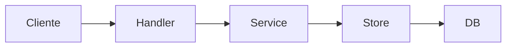
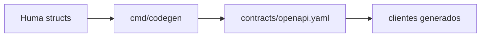

# Arquitectura del servicio de productos

Documento de apoyo para la revisión del Hito 1. Explica cómo está construido
el servicio, qué es simulado hoy y dónde entra la lógica real en el Hito 2.

## Alcance actual

El Hito 1 entrega **contrato publicado y endpoints con datos simulados**. Todavía
no hay base de datos, migraciones, sqlc ni autenticación: eso es Hito 2. Lo que
sí existe es la estructura de capas, el contrato generado y los modos de falla
documentados antes de programar.

## Capas



| Capa | Paquete | Responsabilidad | Lo que no hace |
|---|---|---|---|
| Handler | `internal/api` | Traduce HTTP a tipos Go, valida contra el contrato y elige el código de respuesta | Reglas de negocio, SQL |
| Service | `internal/service` | Reglas de negocio: SKU único, existencia de categorías, costo, `permite_venta` | Conocer HTTP o SQL |
| Store | `internal/store` | Acceso a PostgreSQL y traducción de errores de la base a errores de dominio | Reglas de negocio |

En el Hito 1 el handler implementa los datos en memoria y las capas `service` y
`store` existen como interfaces con `TODO Hito 2`. Es una decisión deliberada:
la estructura se fija ahora, la implementación entra cuando exista PostgreSQL.
Un handler que llame directo al store se rechaza en revisión.

## El contrato como artefacto

El contrato **no se escribe a mano**. Los structs de `internal/api/productos.go`
son la fuente de verdad y `cmd/codegen` genera `contracts/openapi.yaml`, que se
commitea.



Consecuencias:

- El contrato y el código no pueden divergir: el CI corre `pnpm codegen` y falla
  si el YAML commiteado no coincide con los structs.
- Un cambio incompatible se detecta con `oasdiff breaking` contra `main`.
- Los servicios consumidores generan su cliente desde ese YAML, así que los
  nombres de los campos son una interfaz pública.

Detalle no obvio: OpenAPI no permite declarar el `format` de los ítems de un
array desde un tag de Go. Por eso `Producto`, `CrearProductoBody` y
`ActualizarProductoBody` implementan `TransformSchema` y marcan
`categoria_ids[].format = uuid` sobre el esquema ya generado, sin cambiar el
tipo Go (`[]string`).

## Flujo de una petición

Ejemplo: `POST /api/productos`.

1. El mux enruta a la operación Huma registrada en `register.go`
   (`operationId: crear-producto`).
2. Huma valida el cuerpo contra el contrato: campos obligatorios, `minLength`,
   `pattern` del SKU, `minItems` y `uniqueItems` de categorías, `minimum` del
   costo y `format: uuid` en los identificadores. Si algo falla responde `422`
   sin llegar al handler.
3. El handler toma el mutex, revisa si el SKU ya existe y responde `409` en ese
   caso. Esa regla pertenece al service y hoy está simulada.
4. Si todo está bien devuelve `201` con el producto y la cabecera `Location`.

Todos los errores usan `application/problem+json` (RFC 9457), que Huma emite por
defecto. No hay formato de error propio.

## Endpoints

| `operationId` | Método | Ruta | Códigos |
|---|---|---|---|
| `crear-producto` | `POST` | `/api/productos` | `201`, `409`, `422` |
| `listar-productos` | `GET` | `/api/productos` | `200`, `422` |
| `obtener-producto` | `GET` | `/api/productos/{id}` | `200`, `404`, `422` |
| `actualizar-producto` | `PATCH` | `/api/productos/{id}` | `200`, `404`, `409`, `422` |
| `eliminar-producto` | `DELETE` | `/api/productos/{id}` | `204`, `404`, `422` |

Filtros del listado: `categoria_id` (UUID de una categoría) y `permite_venta`.
El filtro es singular a propósito; el producto guarda una lista.

`DELETE` es **baja lógica**: marca `activo = false`. El producto deja de listarse
y de responderse por ID, pero no se borra. Repetir el `DELETE` es idempotente.

## Qué es simulado y qué falta

| Componente | Hito 1 | Hito 2 |
|---|---|---|
| Persistencia | mapa con mutex en el handler | tabla `productos` vía `store` |
| SKU único | chequeo en memoria bajo mutex | `UNIQUE(sku)` + traducción de `23505` |
| Existencia de categoría | no se valida | service + FK de la tabla puente |
| Categorías | `categoria_ids []string` en memoria | tabla puente `producto_categorias` |
| Permisos | `TODO: permiso productos:administrar` | JWT + permisos |
| Trazabilidad | ninguna | `X-Request-Id`, logs, `/healthz`, `/readyz` |

## Modelo de datos previsto (Hito 2)

No implementado. Se documenta para que el contrato y el esquema no se contradigan.

```sql
CREATE TABLE productos (
    id            uuid PRIMARY KEY,
    sku           text NOT NULL UNIQUE,
    nombre        text NOT NULL,
    descripcion   text NOT NULL DEFAULT '',
    costo         bigint NOT NULL CHECK (costo >= 0),
    permite_venta boolean NOT NULL,
    activo        boolean NOT NULL DEFAULT true,
    creado_en     timestamptz NOT NULL DEFAULT now(),
    actualizado_en timestamptz NOT NULL DEFAULT now()
);

CREATE TABLE producto_categorias (
    producto_id  uuid NOT NULL REFERENCES productos(id) ON DELETE CASCADE,
    categoria_id uuid NOT NULL,
    PRIMARY KEY (producto_id, categoria_id)
);
```

La PK compuesta de la tabla puente es la segunda línea de defensa del
`uniqueItems` del contrato: aunque una validación se salte, la base no permite
la misma relación dos veces. Los montos son `bigint` en pesos, nunca `float`.

## Modos de falla y capa que los cubre

| Falla | Contrato | Service | Base de datos |
|---|---|---|---|
| `categoria_ids` vacío | `minItems: 1` | — | — |
| `categoria_ids` con duplicados | `uniqueItems: true` | — | PK compuesta |
| `categoria_ids` con UUID inexistente | solo formato | verifica existencia | FK |
| SKU duplicado concurrente | — | chequeo temprano | `UNIQUE(sku)` |
| Costo negativo | `minimum: 0` | — | `CHECK (costo >= 0)` |
| Vender con `permite_venta=false` | — | servicio de venta | — |

El detalle y cómo se verifica cada uno está en
[`modos-de-falla.md`](./modos-de-falla.md).

## Decisiones abiertas

El modelado de categorías múltiples está en [`decisiones.md`](./decisiones.md).
Quedan por cerrar con el equipo: SKU automático por departamento, `costo` con
IVA, si la categorización es una lista de identificadores o de nombres, y si el
servicio es una instancia por cliente o multi-tenant. Las dos del medio cambian
el contrato y conviene decidirlas antes de que otros grupos generen sus clientes.

## Estructura de paquetes

```text
apps/api/
├── cmd/api/            # arranque, /healthz, /readyz, apagado ordenado
├── cmd/codegen/        # genera contracts/openapi.yaml desde los structs
├── internal/api/       # structs Huma, registro y handlers del Hito 1
├── internal/service/   # TODO Hito 2: reglas de negocio
└── internal/store/     # TODO Hito 2: PostgreSQL
```
