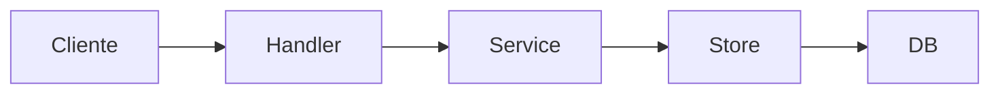
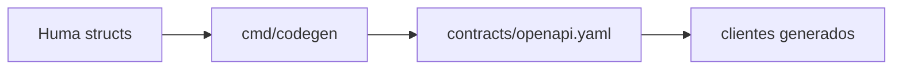

# Arquitectura del servicio de productos

Documento de apoyo para la revisión del Hito 1. Explica cómo está construido
el servicio, qué es simulado hoy y dónde entra la lógica real en el Hito 2.
Refleja el **contrato v1**: SKU autogenerado e inmutable, departamento, costo
unitario con IVA y tipo de impuesto.

## Alcance actual

El Hito 1 entrega **contrato publicado y endpoints con datos simulados**. Todavía
no hay base de datos, migraciones, sqlc ni autenticación: eso es Hito 2. Lo que
sí existe es la estructura de capas, el contrato generado y los modos de falla
documentados antes de programar.

## Capas



| Capa | Paquete | Responsabilidad | Lo que no hace |
|---|---|---|---|
| Handler | `internal/api` | Traduce HTTP a tipos Go, valida contra el contrato y elige el código de respuesta | Reglas de negocio, SQL |
| Service | `internal/service` | Generación del SKU, existencia de departamento y categorías, costo unitario, `permite_venta` | Conocer HTTP o SQL |
| Store | `internal/store` | Acceso a PostgreSQL y traducción de errores de la base a errores de dominio | Reglas de negocio |

En el Hito 1 el handler implementa los datos en memoria y las capas `service` y
`store` existen como interfaces con `TODO Hito 2`. Es una decisión deliberada:
la estructura se fija ahora, la implementación entra cuando exista PostgreSQL.
Un handler que llame directo al store se rechaza en revisión.

## El contrato como artefacto

El contrato **no se escribe a mano**. Los structs de `internal/api/productos.go`
son la fuente de verdad y `cmd/codegen` genera `contracts/openapi.yaml`, que se
commitea.



Consecuencias:

- El contrato y el código no pueden divergir: el CI corre `pnpm codegen` y falla
  si el YAML commiteado no coincide con los structs.
- Un cambio incompatible se detecta con `oasdiff breaking` contra `main`.
- Los servicios consumidores generan su cliente desde ese YAML, así que los
  nombres de los campos son una interfaz pública.

Detalle no obvio: OpenAPI no permite declarar el `format` de los ítems de un
array desde un tag de Go. Por eso `Producto`, `CrearProductoBody` y
`ActualizarProductoBody` implementan `TransformSchema` y marcan
`categoria_ids[].format = uuid` sobre el esquema ya generado, sin cambiar el
tipo Go (`[]string`).

## Flujo de una petición

Ejemplo: `POST /api/productos`.

1. El mux enruta a la operación Huma registrada en `register.go`
   (`operationId: crear-producto`).
2. Huma valida el cuerpo contra el contrato: campos obligatorios,
   `format: uuid` en `departamento_id` y en `categoria_ids`, `enum` de
   `tipo_impuesto`, `minItems` y `uniqueItems` de categorías y `minimum` de
   `costo_unitario`. Si algo falla responde `422` sin llegar al handler.
   `sku` no existe en el cuerpo: enviarlo también da `422`
   (`unexpected property`).
3. El handler toma el mutex y verifica que el departamento exista. Si no existe
   responde `422`; si existe, genera el SKU con el código del departamento y su
   correlativo (`BEB-000001`) y guarda el producto.
4. Si todo está bien devuelve `201` con el producto y la cabecera `Location`.

Todos los errores usan `application/problem+json` (RFC 9457), que Huma emite por
defecto. No hay formato de error propio.

## Endpoints

| `operationId` | Método | Ruta | Códigos |
|---|---|---|---|
| `listar-departamentos` | `GET` | `/api/departamentos` | `200` |
| `crear-producto` | `POST` | `/api/productos` | `201`, `422` |
| `listar-productos` | `GET` | `/api/productos` | `200`, `422` |
| `obtener-producto` | `GET` | `/api/productos/{id}` | `200`, `404`, `422` |
| `actualizar-producto` | `PATCH` | `/api/productos/{id}` | `200`, `404`, `422` |
| `eliminar-producto` | `DELETE` | `/api/productos/{id}` | `204`, `404`, `422` |

Ninguna operación devuelve `409`: el SKU lo genera el servicio, así que no hay
conflicto por un SKU enviado por el cliente. El `PATCH` no acepta `sku` ni
`departamento_id`, porque ambos son inmutables.

Filtros del listado: `categoria_id` (UUID de una categoría), `departamento_id`
(UUID del departamento) y `permite_venta`. El filtro de categoría es singular a
propósito; el producto guarda una lista.

`DELETE` es **baja lógica**: marca `activo = false`. El producto deja de listarse
y de responderse por ID, pero no se borra. Repetir el `DELETE` es idempotente.

## Qué es simulado y qué falta

| Componente | Hito 1 | Hito 2 |
|---|---|---|
| Persistencia | mapa con mutex en el handler | tabla `productos` vía `store` |
| SKU autogenerado | contador por departamento bajo mutex | correlativo dentro de la misma transacción del insert + `UNIQUE(sku)` |
| Existencia del departamento | catálogo simulado en el handler | FK a `departamentos` |
| Formato del SKU | fijo: `<CODIGO>-<6 dígitos>` | configurable por instancia (separador y cantidad de dígitos) |
| Existencia de categoría | no se valida | service + FK de la tabla puente |
| Categorías | `categoria_ids []string` en memoria | tabla puente `producto_categorias` |
| Permisos | `TODO: permiso productos:administrar` | JWT + permisos |
| Trazabilidad | ninguna | `X-Request-Id`, logs, `/healthz`, `/readyz` |

## Modelo de datos previsto (Hito 2)

No implementado. Se documenta para que el contrato y el esquema no se contradigan.

```sql
CREATE TABLE departamentos (
    id     uuid PRIMARY KEY,
    codigo text NOT NULL UNIQUE,
    nombre text NOT NULL
);

CREATE TABLE productos (
    id              uuid PRIMARY KEY,
    sku             text NOT NULL UNIQUE,
    departamento_id uuid NOT NULL REFERENCES departamentos(id),
    nombre          text NOT NULL,
    descripcion     text NOT NULL DEFAULT '',
    costo_unitario  bigint NOT NULL CHECK (costo_unitario >= 0),
    tipo_impuesto   text NOT NULL CHECK (tipo_impuesto IN ('IVA','EXENTO')),
    permite_venta   boolean NOT NULL,
    activo          boolean NOT NULL DEFAULT true,
    creado_en       timestamptz NOT NULL DEFAULT now(),
    actualizado_en  timestamptz NOT NULL DEFAULT now()
);

CREATE TABLE producto_categorias (
    producto_id  uuid NOT NULL REFERENCES productos(id) ON DELETE CASCADE,
    categoria_id uuid NOT NULL,
    PRIMARY KEY (producto_id, categoria_id)
);
```

La PK compuesta de la tabla puente es la segunda línea de defensa del
`uniqueItems` del contrato: aunque una validación se salte, la base no permite
la misma relación dos veces. `costo_unitario` es `bigint` en pesos con IVA
incluido, nunca `float`.

## Modos de falla y capa que los cubre

| Falla | Contrato | Service | Base de datos |
|---|---|---|---|
| `categoria_ids` vacío | `minItems: 1` | — | — |
| `categoria_ids` con duplicados | `uniqueItems: true` | — | PK compuesta |
| `categoria_ids` con UUID inexistente | solo formato | verifica existencia | FK |
| `departamento_id` inexistente | solo formato | `422` | FK |
| `tipo_impuesto` inválido | `enum` | — | `CHECK` |
| Dos altas simultáneas en el mismo departamento | — | correlativo en la transacción | `UNIQUE(sku)` |
| `costo_unitario` negativo | `minimum: 0` | — | `CHECK (costo_unitario >= 0)` |
| Vender con `permite_venta=false` | — | servicio de venta | — |

El detalle y cómo se verifica cada uno está en
[`modos-de-falla.md`](./modos-de-falla.md).

## Decisiones adoptadas

Cerradas por el equipo y reflejadas en el contrato v1:

- **SKU autogenerado e inmutable por departamento**: `<CODIGO>-<SECUENCIAL>`.
- **Departamento**: `departamento_id` UUID obligatorio, inmutable y filtrable;
  el catálogo se publica en `GET /api/departamentos`.
- **Costo unitario con IVA**: `costo_unitario` `int64`, `minimum: 0`.
- **Tipo de impuesto**: `enum IVA | EXENTO`.
- **Categorías como lista simple**: `categoria_ids []string` de UUIDs.
- **Una instancia por cliente**: single-tenant, sin `cliente_id`.

El detalle y las preguntas que siguen abiertas están en
[`decisiones.md`](./decisiones.md).

### Preguntas abiertas

1. Si los departamentos y las categorías viven en este servicio o en otro, y en
   ese caso si se validan por API en cada escritura o con copia local.
2. El formato del SKU por instancia (separador y cantidad de dígitos), que hoy
   es fijo y queda anotado como `TODO Hito 2`.

## Estructura de paquetes

```text
apps/api/
├── cmd/api/            # arranque, /healthz, /readyz, apagado ordenado
├── cmd/codegen/        # genera contracts/openapi.yaml desde los structs
├── internal/api/       # structs Huma, registro y handlers (productos y departamentos)
├── internal/service/   # TODO Hito 2: reglas de negocio
└── internal/store/     # TODO Hito 2: PostgreSQL
```
